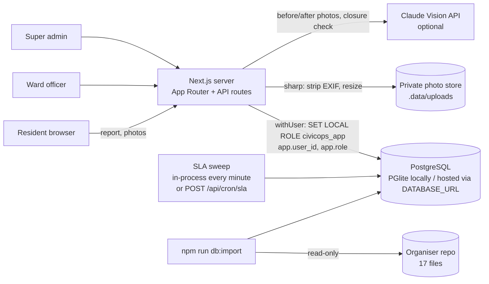
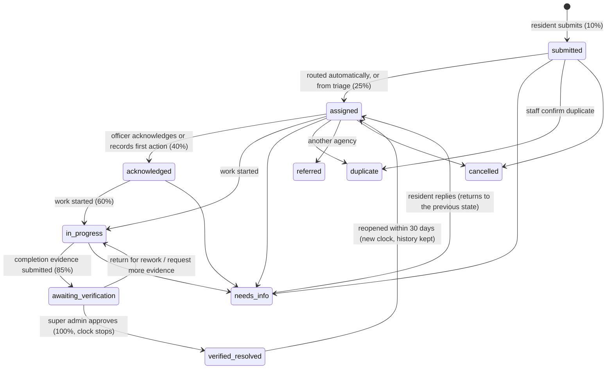
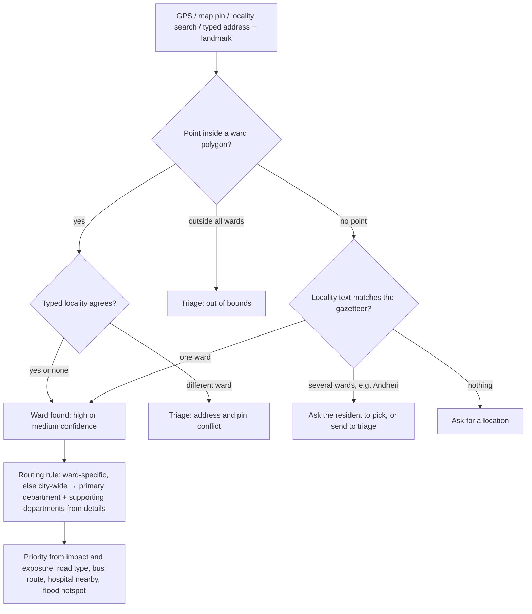
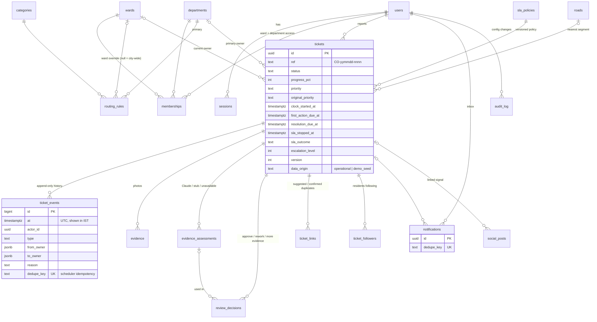
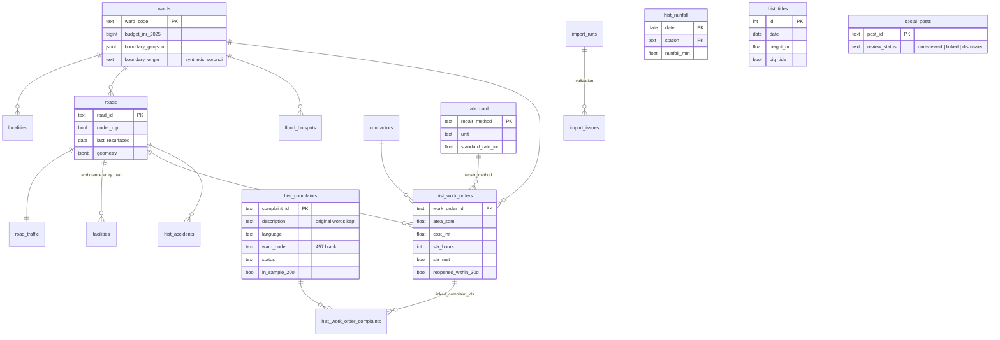

# Architecture

## Components

## Ticket lifecycle (authoritative rules)

Rules enforced in the database (trigger `tickets_guard` and RLS), not only in the app:
- Only a super admin (or the system) can set `verified_resolved`, and only from `awaiting_verification`.
- Residents cannot change routing, priority, deadlines or officers. They can only cancel, reply to an information request, or reopen.
- `original_priority` never changes. Every update bumps `version`, so concurrent edits are detected (409).
- `ticket_events` is append-only for application users.
- The application role cannot read `users.password_hash` or phone numbers (column-level grant).

The app adds: evidence requirements per category (an after photo, or a written reason why none is possible), "access restored" before reviewing a waterlogging ticket, "supply restored" when a water outage was reported, and a 30-day window for residents to reopen.

## Routing

Gazetteer: `localities.csv` names and aliases, including Devanagari (`अंधेरी पूर्व` → K/E). Ward polygons come from `wards.geojson`, a synthetic Voronoi approximation. The repo states that point-in-polygon on them matches its `ward_code` columns.

## Operational data model

## Historical (synthetic) data model

Every imported row carries `data_origin = 'synthetic_repo'`. Source IDs, original descriptions, statuses and timestamps are preserved. Timestamps are read as IST from the dataset and stored as UTC.

## Audit logic (historical)

| Signal | Rule | Count |
|---|---|---:|
| Billed above the rate card | bill ÷ reference > 1.35. The reference is area × rate (per m²) or the flat per-job rate. Every normal job is ≤ 1.32×. | 113 |
| Possible double billing | No linked complaint, and the same road + same work type was billed within 10 days | 45 |
| Paid under defect liability | Road `under_dlp = Y`, and the job came after the last resurfacing | 493 |
| Missed time target (context) | `sla_met = N`, shown with the rainfall during the job and the engineer's remark | 1,259 |
| Failed within 30 days (context) | `reopened_within_30d = Y`, with the redo work order | 611 |
| Inconsistent record | Recorded SLA result contradicts the timestamps | 1 |

Contractor scorecards compare durability with the reopen rate expected for each contractor's mix of repair methods. Speed is shown both overall and excluding jobs that had heavy rain (≥ 64.5 mm/day). The next-rupee plan ranks road segments by open complaints, failed fixes, flood hotspots (including tide sensitivity and the number of 2025 days above each hotspot's flooding threshold), congestion, accidents, ambulance routes, schools and bus routes. It funds the method with the lowest cost per lasting fix, uses pumping only as standby, and claims DLP roads from the original contractor.
